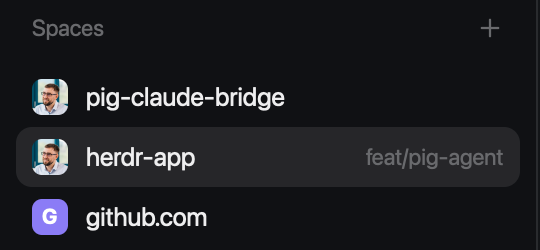

# profile-pictures

A [Herdr](https://herdr.dev) mod: the Spaces sidebar with each repo's owner picture
in place of the letter tile. It works with github.com, GitHub Enterprise (Cloud and
Server) and GitLab. Forks show the upstream's picture by default.



## Install

1. Copy `mods/profile-pictures` to `~/.config/herdr-app/mods/profile-pictures`.
2. In your layout (`~/.config/herdr-app/layouts/<name>.json`; for a shipped one,
   `layout.clone` it first), point the `spaces` block at it:

   ```json
   "content": { "mod": "profile-pictures" }
   ```

3. `herdr-app check ~/.config/herdr-app/mods/profile-pictures`
4. Show that layout: `herdr-app do layout.switch --name <name>`. If the sidebar
   still shows letter tiles, `herdr-app status` names the active layout; switch
   again if it isn't yours.

For GitHub Enterprise, log in with `gh auth login --hostname <host>` so the mod can
reach private-mode servers.

## Options

To show a fork's own owner instead of its upstream's, give the block props:

```json
"content": { "mod": "profile-pictures", "props": { "upstream": false } }
```

## What it reaches

It runs `git` and `ssh -G` to read each repo's `origin`, and `gh`, `curl`, `sh` and
`file` to look up and download pictures. It calls the GitHub or GitLab API of each
remote's host. Pictures are cached in `mods/profile-pictures/.cache/`.

## Custom images

This mod only shows pictures from GitHub or GitLab. To pick your own image for a
space, use [herdr-space-avatars](https://github.com/juliorr/herdr-space-avatars):
right-click a space, **Set icon…**, and paste or drop an image. It also takes a
per-repo image from a folder. Both mods replace the same Spaces block, so use one
or the other.

## Uninstall

Set the block back to `"content": { "mod": "spaces" }`, then delete
`~/.config/herdr-app/mods/profile-pictures`.

## Develop

`node mods/profile-pictures/remote.test.mjs` runs the lookup tests. `RECIPE.md`
describes the mod in full.
