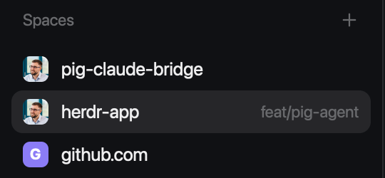

# Profile pictures

The Spaces sidebar you already know, but a space whose repo lives on GitHub (github.com, GitHub Enterprise Cloud or GitHub Enterprise Server), GitLab, Forgejo or Gitea shows the owner's picture where the colored letter tile was. A fork shows the picture of the repo it was forked from, unless you turn that off. Spaces that aren't in a repo, or whose remote has no picture you can reach, keep their letter. Everything else about Spaces stays the same. This is a piece for your own window: you point your layout's Spaces block at it.

This file is the brief: enough to build Profile pictures from an empty folder. The files next to it are one build of it. If they don't work on your Herdr, or you want it different, build it again from here.

## What you see

- The Spaces list, top to bottom: a 31px header ("Spaces" in 11.5px `dim` text, a 26px + button on the right), then one row per space on the `chrome` background, grouped by machine when more than one is known.
- Each top-level row is 30px high, 8px horizontal padding, 8px corner radius, `selected` background when active. On the left sits an 18×18px avatar with a 5px radius:
  - **A picture** when the repo's `origin` is on:
    - github.com: the owner's picture.
    - GitHub Enterprise Cloud with data residency (`<name>.ghe.com`) or GitHub Enterprise Server (any other host that answers GitHub's API): the owner's picture, through your `gh` login for that host.
    - GitLab, on gitlab.com or any host that answers GitLab's API: the project's avatar, else its group's or user's. Public projects only.
    - Forgejo or Gitea (Codeberg, or any other host): the repo's avatar, else its owner's picture. A server that answers its API only to signed-in users still shows the remote owner's picture; with the person's `~/.netrc` login for that host it also shows repo avatars and knows forks.
  - **A fork's picture is its upstream's** by default: the repo it was forked from (GitHub's and Forgejo's `parent`, GitLab's `forked_from_project`), with that repo's avatar or its owner's picture. With `"props": { "upstream": false }` on the layout block, a fork shows its own instead.
  - **The letter tile** otherwise: the first letter of the space name, uppercase, 10.5px bold white on the space's color (`#22a99a`, `#e3814f`, `#5b8def`, `#8b7cf6`, `#3fae6a`, `#d9649a`, the same colors shipped Spaces uses).
- The space name (13px `foreground`, max 150px, truncated), then on the right in 11.5px `dim`: the repo name and branch when they're unusual (not main/master, not the same as the space name), green `↑n` ahead and pink `↓n` behind.
- Worktree spaces sit under their repo's row, 28px high, indented 22px with a branch icon instead of an avatar. They get no picture.
- In the narrow rail (sidebar under 160px) rows show a number and a status dot, as in shipped Spaces. No pictures there.

## How it behaves

- A picture shows up a moment after the space's git info, once its download finishes. Until then, and if every way to get it fails, the row shows the letter tile. Rows never jump or resize when a picture arrives.
- Pictures are looked up once per repo each time the mod starts (a layout switch, an app restart, saving a file in the mod, changing the block's props). A changed picture shows after the next start.
- Changing `upstream` in the layout restarts the mod, and the forks switch pictures.
- A remote like `git@work:org/repo.git`, where `work` is a `Host` alias in `~/.ssh/config`, is looked up on the host the alias points to.
- Agent status: in the rail, blocked and done show `●` in the `blocked` / `done` color, working and idle show `·`. Wide rows show no status: agents are in the Agents list.
- Click a row to switch to that space. Drag rows to reorder spaces within their machine (an accent line shows where it lands). Right-click a row for the shipped space menu. The + button makes a new space. Machine headers fold and unfold, and offer "New space there".
- Nothing animates. There are no keys of its own.

## Built from

- **One mod**, `mods/profile-pictures/`: `main.js`, `remote.js`, `remote.test.mjs`, and `mod.json` (`{ "place": "none", "title": "Profile pictures" }`). No `keys.json` and no layout: it replaces the `spaces` block's content in a layout you already have, optionally with `"props": { "upstream": false }`.
- **A clone of the shipped `spaces` mod**: `herdr-app do mod.clone '{"name":"spaces","as":"profile-pictures"}'`, then the additions below. Keep everything else as shipped: git status per space, worktree nesting, machine grouping, drag to reorder, `shared("space.colors")`, the `menu` popup.
- **`remote.js`**, plain functions node can test (`node mods/profile-pictures/remote.test.mjs`, with a fake `exec`):
  - `parseRemote(url)`: `git@github.com:owner/repo.git`, `https://gitlab.com/group/sub/repo`, `ssh://git@host:22/a/b.git` → `{ host, path }` (host lowercased, `.git` and slashes trimmed), or `null`. The host must start with a letter, digit or `_` (ssh aliases like `github_work` are fine), so it can't pass ssh or gh an option.
  - `realHost(host, sshConfig)`: the `hostname` line of `ssh -G <host>`, with `ssh.github.com` → `github.com` and `altssh.gitlab.com` → `gitlab.com` (SSH over port 443).
  - `apiBase(host)`: `https://api.github.com/`, `https://api.<name>.ghe.com/`, else `https://<host>/api/v3/`.
  - `pictureFor({ host, path }, upstream, exec)` → `{ id, sources }` or `null`. `id` names the cached file. Each source is `{ url }` (anyone may download it) or `{ url, gh: true }` (fetched through gh, which adds the person's login for the URL's host).
    1. Unless the host name contains `gitlab`, ask GitHub: `gh api --hostname <host> repos/<path>`, else anonymously `curl -fsSL --max-time 15 <apiBase>repos/<path>`. With an answer, the owner is `parent.owner` when `upstream` is on and the repo is a fork, else `owner`. Its `avatar_url` gets `s=64`. github.com: that URL alone, `id` `<host>_<login>`. Enterprise: first `{ url, gh: true }`, with `<apiBase>enterprise/avatars/u/<owner id>?s=64` on Server and the avatar URL itself on ghe.com, then the plain URL (a server in public mode).
    2. No answer on github.com (rate limit, a private repo without gh): `https://github.com/<owner>.png?size=64`, the remote's owner.
    3. Otherwise, ask GitLab: `curl https://<host>/api/v4/projects/<url-encoded path>`. With `upstream` and `forked_from_project`, use that project, else this one: its `avatar_url`, else `namespace.avatar_url`. A path starting with `/` is put on `https://<host>`. `id` `<host>_<path_with_namespace>`. With an answer, or on a host whose name contains `gitlab`, stop here: a project without an avatar keeps its letter.
    4. Otherwise, ask Forgejo or Gitea: `curl -fsSL --max-time 15 --netrc-optional https://<host>/api/v1/repos/<path>`. With an answer, the repo is `parent` when `upstream` is on and the repo is a fork, else this one. When that repo's `avatar_url` is not empty, it is the source, with `id` `<host>_<full_name>`. Otherwise its owner's: the sources are `https://<host>/user/avatar/<login>/64`, then the owner's `avatar_url`, with `id` `<host>_<login>`.
    5. No answer there either (a server that answers its API only to signed-in users, a private repo): `https://<host>/user/avatar/<owner>/64`, the remote's owner, which Forgejo serves to anyone. On a server of another kind that address gives no image, and the row keeps its letter.
- **`main.js`**:
  - `init`: `this.upstream = props()?.upstream !== false`, with `props` imported from `herdr`.
  - Once per repo (`this.pics[repo]`, set to `null` first so it's never asked twice), after the clone's git check has stored a repo: `exec("git", ["remote", "get-url", "origin"], { cwd, on })`. For a remote that isn't http(s), `exec("ssh", ["-G", host], { on })` and `realHost`. Then `pictureFor(remote, this.upstream, exec)` (gh and curl run on this computer).
  - The file is `mods/profile-pictures/.cache/<id>.png`, with anything other than `[\w.-]` in `id` replaced by `_`. One download per file per start (`this.got[file] ??= …`), since an owner's repos share it.
  - Download: try each source until one gives an image. Skip a URL that isn't `http(s)://` (`https://` only for gh). `{ url }`: `curl -fsSL --max-time 15 --create-dirs -o <file> -w %{content_type} <url>`, accepted only if it prints `image/…`. `{ url, gh: true }`: `sh -c 'mkdir -p "$(dirname "$2")" && gh api "$1" > "$2" && file -b --mime-type "$2"' sh <url> <file>`, also accepted only on `image/…`. On success, store the path and `cx.notify()`.
  - Drawing: in the row, when not a worktree row and `this.pics[g?.repo]` is set, `image(path).size(18).flex_none().rounded(5)` instead of the letter tile.
- **Herdr functions**: `spaces`, `machines`, `panes`, `run` (`space.select`, `space.move`, `space.new`), `openOverlay` (the shipped `menu`), `exec`, `hc`, `theme`, `shared` / `setShared`, `watchFolder`, `layout`, `window`, `appHome`. Icons: `mods/workspace-chrome/plus.svg` and `branch.svg` from the shipped mods.
- **Programs**: `git` and `ssh -G` (on the space's machine); `gh`, `curl`, `sh` and `file` (here). **Network**: the API of each remote's host (GitHub's, then GitLab's, then Forgejo's, for a host that is not GitHub), github.com, avatars.githubusercontent.com, a Forgejo host's `/user/avatar/`, and the avatar URLs those APIs return. **Files**: `~/.netrc`, read by curl for the Forgejo API call only.

## Watch out

- **Use it in a layout:** this mod has `place: "none"`. Set the `spaces` block's `content.mod` to `profile-pictures` in your own layout. Shipped layouts are read-only, so for Herdr (main) clone it first, `herdr-app do layout.clone '{"name":"main","as":"main-pictures"}'`, and edit `layouts/main-pictures.json`. `ctrl-shift-l` switches back.
- **Read the option with `props()`.** The layout block's props come from `herdr`'s `props()`, not from `init`'s first argument, which doesn't carry them, so reading that one leaves `upstream` stuck on. The shipped `win98` mod reads `props() ?? p` for the same reason.
- **API answers are untrusted.** The mod asks the API of whatever host a remote names, and the URLs it gets back become `curl` and `gh` arguments. Without the `http(s)://` check, an answer like `-o/some/path` would be read as an option.
- **Check the content type.** A private-mode Enterprise Server sends anonymous avatar requests to its login page, which answers `200 text/html`, so `curl -f` succeeds. Without the `image/` check that page is saved and drawn as a broken picture.
- **Enterprise avatar URLs from the API don't load anonymously** (private mode). Enterprise Server 3.0+ serves them at `/api/v3/enterprise/avatars/u/<id>` to a request with the person's token (GitHub Desktop and GitLens do the same). Going through `gh api` sends that token without the mod ever holding it. It never shows up on a command line, and gh only sends it to the host it belongs to.
- **Enterprise needs `gh auth login --hostname <host>`.** Without it a private-mode server answers `401` and the row keeps its letter. On github.com, gh also gets private repos' fork info; without it the anonymous API allows 60 requests an hour, after which forks show their own owner by name.
- **Not run against a server with a login yet:** Enterprise Server was tested anonymously (private mode → letter) and through fakes in the test. ghe.com is untested. GitHub Desktop needs a special avatar token there, so a ghe.com picture may stay a letter. To check a server, run `gh api --hostname <host> "enterprise/avatars/u/$(gh api --hostname <host> user -q .id)?s=64" > /tmp/me.png && file /tmp/me.png`. A PNG or JPEG means it works.
- **Forgejo's API often wants a login, its avatars don't.** Many servers answer `/api/v1` only to signed-in users (`403`), but serve `/user/avatar/<name>/<size>` to anyone, redirecting to the picture. So the owner's picture needs no login; a repo's avatar and a fork's upstream do, through the API (the repo avatar's file itself downloads without one). curl's `--netrc-optional` sends the `~/.netrc` login of that host only, and the mod never holds it. Don't ask `/<owner>.png` instead: a server like that answers it with its login page.
- **Cache per picture, not per repo.** GitHub pictures are cached by owner, GitLab's by project, Forgejo's by repo for a repo avatar and by owner otherwise, so turning `upstream` off downloads into a different file instead of rewriting one Herdr may already have drawn.
- **Cache in a hidden folder.** Saving any non-hidden file in the mod folder hot-reloads it, and a reload looks up every picture again. `.cache/` is hidden, so it doesn't. It's never pruned; delete it to clear it.
- **Draw the image only after the file exists.** The build never points `image()` at a path whose download hasn't finished.
- `upstream` means GitHub's `parent`, the repo it was forked directly from, not the root of a fork chain.
- GitLab is anonymous: private projects keep the letter. GitLab returns a group's avatar as a path (`/uploads/…`); put it on the host.
- Files are always named `.png`. GPUI reads the content, so JPEG avatars (common on GitHub) draw fine.
- Only `origin` is read. A repo with no `origin` keeps its letter.
- Windows has no `sh`, so enterprise pictures stay letters there; public ones still work through `curl`.
- `curl` must be on the PATH Herdr sees. Without it every row keeps its letter, with no error.
- The mod reaches the network and runs `git`, `ssh`, `gh`, `curl`, `sh` and `file`. Tell the person before installing it.

## Done when

- `herdr-app check mods/profile-pictures` passes, and `node mods/profile-pictures/remote.test.mjs` prints `ok`.
- With the layout's `spaces` block set to `profile-pictures`, a space in a clone of a github.com repo shows the owner's picture at 18px with rounded corners, and `mods/profile-pictures/.cache/` holds its file.
- A space whose `origin` is a github.com fork (`jfrazier/Spoon-Knife`) shows its upstream owner's picture (`octocat`). With `"props": { "upstream": false }` it shows `jfrazier`'s.
- A space whose `origin` is a gitlab.com fork (`ngasinan/gitlab-ce`) shows GitLab FOSS's avatar (the logo on a white tile), and its own with `upstream` off (the logo alone).
- A space whose `origin` is a Codeberg fork (`forgejo-aneksajo/forgejo-aneksajo`) shows the `forgejo/forgejo` repo's avatar, and the `forgejo-aneksajo` owner's picture with `upstream` off (that repo has no avatar).
- A space whose `origin` is a Forgejo repo with an avatar of its own shows that avatar, not its owner's picture.
- A space whose `origin` is on a Forgejo server that answers its API only to signed-in users, with no `~/.netrc` login for it, shows the remote owner's picture.
- Changing the block's props switches those forks' pictures within seconds, without restarting Herdr.
- An ssh remote (`git@github.com:torvalds/linux.git`) shows its owner's picture, a JPEG.
- A space whose `origin` is on a private-mode Enterprise Server you aren't logged in to (`https://github.umn.edu/...`) keeps its letter, and no file appears for it in `.cache/`.
- A space in your home folder (not a repo) shows the colored letter tile.
- Clicking, dragging to reorder, right-clicking for the menu, + for a new space and the narrow rail all work as in shipped Spaces.
- With the network off, the mod still loads and every row shows its letter.
